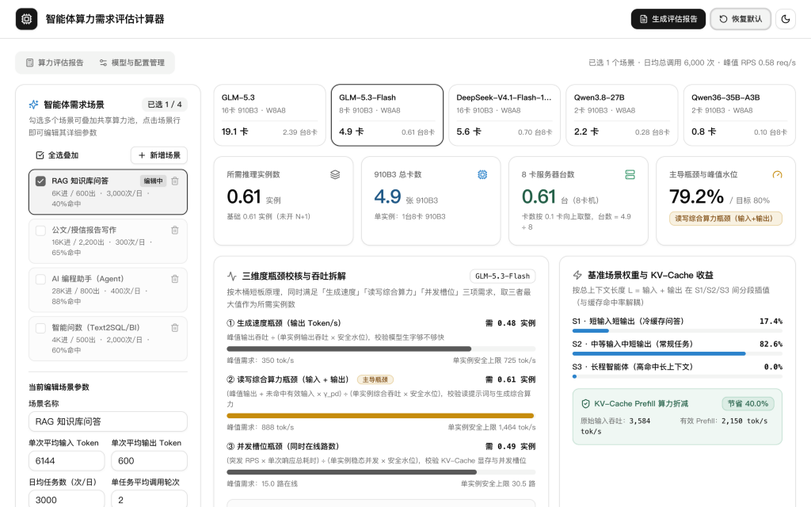
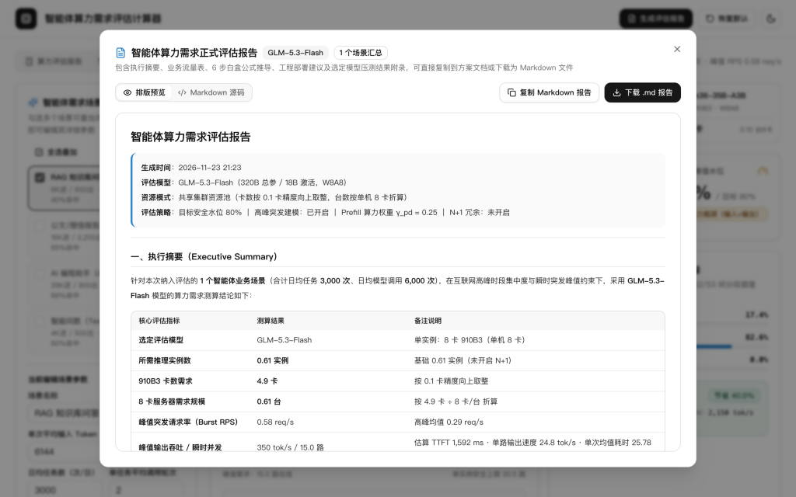
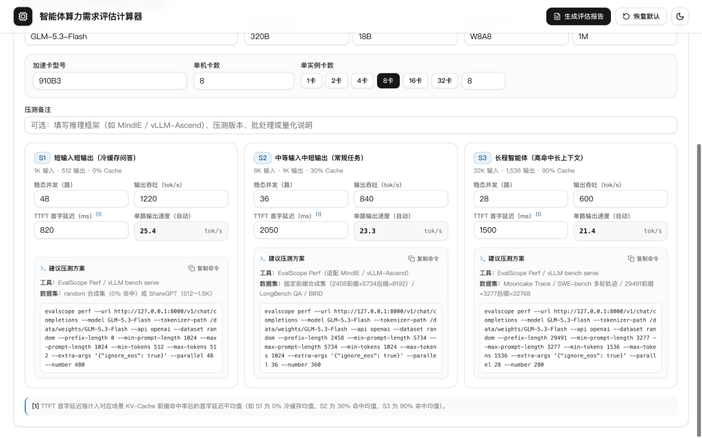

# 智能体算力需求评估计算器（Agent Compute Estimator）

一款纯前端 TypeScript 实现的大模型智能体算力需求评估工具。输入业务场景流量与技术参数、选择目标模型与硬件规格，即可实时输出 **共享算力池卡数（精确到 0.1 卡）、服务器台数、三维度瓶颈校核、6 步白盒公式推导**，并一键生成可复制/下载的正式 Markdown 评估报告。

---

## 界面预览

### 1. 算力评估报告（主视图）
左侧支持多选智能体业务场景叠加与参数微调，右侧实时呈现模型快选、核心硬件规模、三维度短板校核、S1/S2/S3 基准权重、6 步白盒公式推导与多模型横向对比。



### 2. 正式评估报告（Markdown 实时渲染 & 导出）
点击顶部 **「生成评估报告」** 即可在线预览完整排版报告（含执行摘要、业务流量表、6 步推导、部署建议与选定模型压测结果附录），支持一键复制或下载 `.md` 文件。



### 3. 模型规格与三场景压测基准配置
支持自由新增/编辑模型、自定义加速卡型号（默认 `910B3`）、单实例卡数与单机卡数，内置 **EvalScope Perf** 压测工具、推荐数据集与动态联动命令（一键复制），所有配置自动持久化至 `localStorage` 并支持 JSON 一键导入/导出。



---

## 核心特性

- **多选智能体场景池化叠加**：内置 4 套企业级典型智能体场景（`RAG 知识库问答`、`公文/授信报告写作`、`AI 编程助手 Agent`、`智能问数 Text2SQL/BI`），支持多选勾选叠加共享算力池，也支持自由新增与删除自定义场景。
- **互联网高峰突发建模（可开关）**：支持按高峰时段时长、高峰流量占比与瞬时峰值系数（Peak/Avg）估算突发 RPS；关闭后自动切换为全天 24 小时均摊模式。
- **解耦式三场景基准插值与超长上下文外推**：
  - **S1（短进短出，冷缓存问答）**：`1K` 输入 / `512` 输出 / `0%` Cache Hit
  - **S2（中等输入，常规业务）**：`8K` 输入 / `1K` 输出 / `30%` Cache Hit
  - **S3（长程智能体，高命中长上下文）**：`32K` 输入 / `1.5K` 输出 / `90%` Cache Hit
  - 吞吐与并发仅随总上下文长度 `L = 输入 + 输出` 在对数轴分段线性插值（`L > 32K` 时按 KV 显存守恒与幂律衰减外推），`TTFT` 独立按未命中 Prefill 量 `E = 输入 × (1 - cacheHit)` 插值/外推，彻底杜绝“缓存命中率越高卡数越多”的反物理倒挂。
- **三维度短板校核（木桶原理）**：
  1. **生成速度瓶颈（输出 Token/s）**：`峰值输出吞吐 ÷ (单实例输出吞吐 × 安全水位)`
  2. **读写综合算力瓶颈（输入 + 输出）**：`(峰值输出 + 未命中有效输入 × γ_pd) ÷ (单实例综合吞吐 × 安全水位)`
  3. **并发槽位瓶颈（同时在线路数）**：`(突发 RPS × 单次响应总耗时) ÷ (单实例稳态并发 × 安全水位)`
- **共享资源 0.1 卡取整 & 可选 N+1 容灾**：卡数按 `0.1` 卡向上取整，服务器台数按 `总卡数 ÷ 单机卡数` 直接折算，支持 N+1 热备开关与目标安全水位（默认 `80%`）调节。
- **内置 5 款昇腾 910B3（64GB）模型基准**：`GLM-5.3`、`GLM-5.3-Flash`、`DeepSeek-V4.1-Flash-1017`、`Qwen3.8-27B`、`Qwen36-35B-A3B`，每项压测仅需维护 **稳态并发、输出吞吐、TTFT** 三个核心指标，自动反算单路输出速度与纯生成 TPOT。
- **纯前端零后端**：所有计算在浏览器本地完成，配置自动持久化至 `localStorage`，支持 JSON 一键导入/导出。

---

## 技术栈

- **框架**：React 19 + TypeScript + Vite 6
- **UI 体系**：[coss.com/ui](https://coss.com/ui)（`@base-ui/react` + Tailwind CSS v4 OKLCH 语义 Token + `class-variance-authority` + `lucide-react`）
- **报告渲染**：`react-markdown` + `remark-gfm`

---

## 快速开始

```bash
npm install
npm run dev
```

生产构建：

```bash
npm run build
npm run preview
```

---

## 目录结构

```text
src/
├── components/
│   ├── ui/                    # coss.com/ui 基础组件（基于 @base-ui/react）
│   ├── HeaderBar.tsx          # 顶部导航、报告入口与主题切换
│   ├── WorkloadPanel.tsx      # 多选智能体场景列表与全局策略面板
│   ├── ResultDashboard.tsx    # 核心指标、三维度瓶颈与场景权重仪表盘
│   ├── FormulaExplanation.tsx # 6 步白盒公式推导手风琴
│   ├── ModelComparisonTable.tsx # 多模型横向算力对比表
│   ├── ModelConfigManager.tsx # 模型规格、S1/S2/S3 压测与 JSON 导入导出
│   └── ReportDialog.tsx       # 正式 Markdown 评估报告预览与导出弹窗
├── data/
│   └── presets.ts             # S1/S2/S3 锚点、5 款模型与 4 套业务 Preset
├── engine/
│   └── calculator.ts          # 纯 TypeScript 6 步算力评估计算引擎
├── lib/
│   ├── format.ts              # 数值与百分比格式化工具
│   ├── report.ts              # 正式 Markdown 报告生成器
│   ├── storage.ts             # localStorage 持久化与 JSON 导入导出校验
│   └── utils.ts               # Tailwind 样式合并工具
└── types/
    └── calculator.ts          # 全量 TypeScript 类型定义
```
